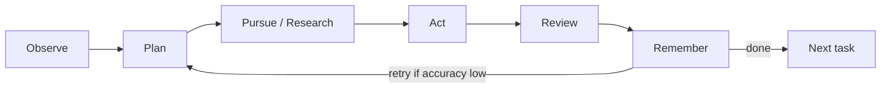

# Piya

A continuous AI agent with **vector memory** and an explicit **OPPAR loop** — built in Rust for a single native binary, low overhead, and predictable daemon behavior.

## How it works



| Phase | What happens |
|-------|--------------|
| **Observe** | Pull next task; recall similar past work from vector memory |
| **Plan** | LLM creates steps + success criteria + research queries |
| **Pursue** | DuckDuckGo search + page fetch when external info is needed |
| **Act** | Write files and run safe commands in `workspace/` |
| **Review** | Self-critique against success criteria; score 0–1 accuracy |
| **Remember** | Store learnings, corrections, and outcomes with embeddings |

### Models

**Settings → Models** picks one provider + model for everything (chat, tasks, scheduled actions):

| Provider | Connection |
|----------|------------|
| OpenAI | API key |
| Anthropic (Claude) | API key — native Messages API |
| Google Gemini | AI Studio key |
| OpenRouter, Groq, Mistral, DeepSeek, xAI | API key |
| Ollama, LM Studio | Local server, no key |
| Other OpenAI-compatible server | Address + optional key |

The model list comes live from your account (**Refresh models**), and **Test** sends one tiny request. Keys are saved
per provider (`PIYA_KEY_<PROVIDER>` in `~/Library/Application Support/Piya/.env`, mode 600), so switching back does not
need a re-paste. A key that looks like another provider's (e.g. `sk-ant-…` under OpenAI) is flagged before saving.
Models that reject `temperature` or JSON mode are detected and retried without them.

**Memory (embeddings)** has its own setting, because many chat providers (Claude, Groq, …) have no embeddings API:
OpenAI, Gemini, Mistral, Ollama, LM Studio or any compatible server, or Off. Changing it re-indexes saved memories
automatically; a `memory-backup-*.jsonl` is written to the data folder first.

CLI / `.env` equivalents: `PIYA_PROVIDER`, `PIYA_MODEL`, `PIYA_KEY_<PROVIDER>`, `PIYA_BASE_URL_<PROVIDER>`,
`PIYA_EMBED_PROVIDER`, `PIYA_EMBEDDING_MODEL`. Existing installs with only `OPENAI_API_KEY` keep working as OpenAI.

### Voice & Media Input

In the Hummingbird chat composer:

- **Voice dictation (`⌃⇧Space` or mic button):** Uses Apple's on-device `SFSpeechRecognizer` (private and free) to stream live speech directly into the composer.
- **Attachments (paperclip, drag & drop, or `⌘V`):**
  - **Images (`png`, `jpg`, `webp`, `gif`, screenshots pasted with `⌘V`):** Sent natively as vision blocks to OpenAI-compatible and Anthropic models.
  - **PDFs & text documents:** Extracted locally via `PDFKit` / UTF-8 and indexed for full-text search across sessions.
  - **Audio files (`m4a`, `mp3`, `wav`, …):** Transcribed on-device via `SFSpeechURLRecognitionRequest` and attached with their transcript.

### Long-Term Memory, Daily Reflection & Learned Skills

Everything lives in **one SQLite database (`data/piya.db`, WAL mode)** so Piya remembers what you discuss and improves day by day without LanceDB overhead:

1. **Structured Notes (always in context):** Active notes across `about`, `preferences`, `people`, `routines`, `lessons`, and `opinions` are injected as a compact index into every chat and task turn.
   - **Quote-verified anti-injection:** Model-proposed notes (`piya_memory_learn` and daily reflection) must include a verbatim quote from **your own words** (typed or voice-transcribed). Tool outputs, files, and web pages cannot plant false memories. Secrets and payment card numbers are blocked automatically.
   - **Corrections replace, never duplicate:** Updating a fact ("Anna handles invoices now, not Bob") archives the older note with a `replaced_by` link.
2. **Searchable Conversation & Attachment History:** Every chat message, PDF extract, and audio transcript is indexed in SQLite FTS5 (`piya_history_search`, plus automatic top matches when your message references earlier work).
3. **Daily Reflection & Reasoned Opinions:** Once per day (`piya reflect` or **Settings → Memory → Reflect Now**), Piya repairs expired/duplicate notes, extracts tentative learnings from recent chats (`tentative` → promoted to `learned` when repeated), and can form revisable technical/workflow `opinions`.
4. **Learned Procedural Skills:** Reusable multi-step procedures (`piya_skill_save` / `piya_skill_read` / `piya_skill_patch`) are indexed on every turn. Editing a skill in **Settings → Memory → Skills** locks it so Piya asks before overwriting it.

### Desktop Activity & Work Context (Littlebird-style, 100% Local)

Piya passively tracks what you are working on across macOS apps so you never have to brief her from scratch (`Settings → Activity` or `piya activity`):

- **Capture modes (`Settings → Activity`):**
  - **Full:** Active apps, window titles, browser URLs / document paths + Accessibility text + on-device Apple Vision OCR (`VNRecognizeTextRequest`) for canvases/PDFs (screenshots are discarded immediately).
  - **Text Only *(default)*:** Active apps, window titles, URLs/paths, and visible Accessibility text — zero screenshots or OCR.
  - **App Activity Only:** Only app names, window titles, URLs/paths, and active duration — never reads window body text.
  - **Off** (plus **Pause for 1 Hour / Pause for Rest of Today / Resume** right in the menu bar).
- **Privacy & Retention:** Automatically skips password managers (**1Password**, **Apple Passwords**, **Keychain Access**, **Bitwarden**), `AXSecureTextField` password inputs, and **Private / Incognito** browser windows; scrubs API keys and card numbers; prunes detailed window logs after **30 days** (configurable) while keeping compact daily rollups (`activity_rollups`) long-term. Never creates unsolicited tasks from observed screen content.

### Notifications

Normal notifications are Notification Center banners. **Major alerts** open a panel in the middle of the screen that
floats above full-screen apps on every Space and stays until you click **Done** or **Snooze** (5 min – 1 h). Piya uses
them when you ask for it ("make sure it pops up on my screen") or for urgent items — `piya_notify` / `piya_schedule_create`
take `major: true`. They show even in Quiet mode; only Off hides them. Without the menu-bar app running, a system alert
is used instead. Try it from **Settings → Notifications → Test major alert**.

Memories are retrieved with **accuracy-weighted cosine similarity** — high-quality past work surfaces first.

### What goes where

Chat is the front door. The model routes each message with real tools (no keyword matching):

| Request | Handled by | LLM loop? |
|---------|-----------|-----------|
| Questions, facts, small talk | Answered directly in chat | No |
| "Remind me…", "set a timer…", "every weekday at 6:30…" | `piya_schedule_create` → `reminder` row → banner at the time | No |
| "Every day at 8, check X and tell me" | `piya_schedule_create` → `action` row → one short tool-using turn at the time | Short turn |
| "Remove/cancel/move that reminder" | `piya_schedule_list` → `piya_task_cancel` / `piya_schedule_update` | No |
| "Send me a notification" | `piya_notify` | No |
| Substantial multi-step work (reports, documents, code) | `piya_task_queue` with a `done_when` → OPPAR loop | Yes |

Every chat turn sees the live task ledger (ids, kinds, next runs) and the current local time, so follow-ups like
"actually cancel that" resolve to real ids. Tool results say `Saved ✔` / `Cancelled ✔` from a database read-back;
the model is told to claim only what a tool confirmed.

In the OPPAR loop, the reviewer judges **tool evidence**, not the executor's summary. A task with no successful
tool output, or whose `done_when` is not met, cannot pass.

### Evals

```bash
piya eval            # 14 basic errands against the real model, in a throwaway data dir
piya eval -n 3       # each case 3 times
piya eval -f cancel  # only cases whose name contains "cancel"
```

Each case asserts on **state** (task ledger rows, run times, notifications, workspace files), never on wording.

### Cleanup after upgrading

```bash
piya cleanup --dry-run   # show legacy reminder tasks + agent memories that taught the old behaviour
piya cleanup             # cancel / delete them (memories you saved yourself are never touched)
```

## Quick start

```bash
git clone https://github.com/HeroicCommit/piya.git
cd piya

cp .env.example .env
# Set OPENAI_API_KEY in .env (or pick another provider in Settings → Models)

cargo build --release
# binary: target/release/piya

# Or run directly
cargo run -- status
```

### Add a task

```bash
cargo run -- add "Research competitor pricing" \
  "Find pricing tiers for 3 SaaS tools in the live-chat space. Write a summary markdown file." \
  --priority 1 --tags "research,saas"
```

### Run the agent

```bash
cargo run -- run              # process all pending tasks, then exit
cargo run -- run --once       # one task
cargo run -- run --continuous # daemon (polls every 30s)
```

### SwiftUI app (Menu bar + Hummingbird)

Native menu bar + **Hummingbird** floating panel (SwiftUI + Rust via UniFFI):

```bash
./scripts/build-swift-app.sh           # stages dist/build.noindex/PiyaSwift.app (leaves /Applications untouched)
./target/release/piya app --install    # first-time install to /Applications/Piya.app + login item
```

#### Updating & Releases (no reinstall needed)

- **In-app self-update:** **Menu bar → Check for Updates…** (or **Settings → General → Check for Updates**) downloads the latest GitHub Release, verifies its SHA-256 checksum & code signature, waits for active tasks to finish, atomically swaps `/Applications/Piya.app` in place, and relaunches — keeping `.env`, `data/`, `workspace/`, and Login Item untouched.
- **CLI self-update:** `piya update` (or `piya update --check`, or `piya update --local` to promote a local staged build in place).
- **Side-by-side dev preview:** `./scripts/build-swift-app.sh --dev` builds `dist/build.noindex/PiyaDev.app` (`com.piya.swiftui.dev`) so you can test changes without stopping `/Applications/Piya.app`.
- **Publish a new release:** `./scripts/release.sh 0.2.1` (or push tag `v0.2.1` to trigger `.github/workflows/release.yml`) packages `Piya-macos-arm64.zip` + `SHA256SUMS` and creates a GitHub Release without modifying your installed app.

See [macos/README.md](macos/README.md). The legacy `tao/wry` app (`build-macos-app.sh`) still works during migration.

### macOS app (legacy wry)

Install Piya as a **native menu bar app** — no terminal for daily use.

```bash
./scripts/build-macos-app.sh           # builds dist/Piya.app
./target/release/piya app --install    # /Applications + login item
```

Open **Piya** from Applications or Spotlight. Use the menu bar icon:

| Menu | Action |
|------|--------|
| Assign Task… | Native macOS dialog |
| Run Next / Run All | Background worker (`data/piya-worker.log`) |
| View Queue… | Task summary dialog |
| Open Workspace / Project | Finder |
| About / Quit | Standard app menu |

CLI + MCP still work for OpenClaw and scripts.

**Notification Center:** When Piya.app is running, tasks trigger macOS banner popups (enable in **System Settings → Notifications → Piya**). Default `PIYA_NOTIFY=all` — use `badge` for menu bar only, `0` to disable.

### Terminal mode (optional)

```bash
./target/release/piya              # arrow-key menu
./target/release/piya watch        # TUI dashboard
./target/release/piya run --once   # colored OPPAR output
```

### Inspect state

```bash
cargo run -- status
cargo run -- list
cargo run -- list --status pending
cargo run -- recall "live chat pricing research"
```

## Configuration

| Variable | Default | Description |
|----------|---------|-------------|
| `OPENAI_API_KEY` | — | Required. Any OpenAI-compatible API works |
| `OPENAI_BASE_URL` | `https://api.openai.com/v1` | Base URL for compatible providers |
| `PIYA_MODEL` | `gpt-4o-mini` | Chat model |
| `PIYA_EMBEDDING_MODEL` | `text-embedding-3-small` | Embedding model for vector memory |
| `PIYA_WORKSPACE` | `./workspace` | Where artifacts are written |
| `PIYA_DATA_DIR` | `./data` | Single `piya.db` SQLite store (tasks, chats, FTS5 history, notes, skills, vector memories) + `attachments/` |
| `PIYA_POLL_INTERVAL_SEC` | `30` | Continuous mode poll interval |
| `PIYA_MIN_ACCURACY` | `0.7` | Pass threshold for review |
| `PIYA_MAX_RETRIES` | `3` | Re-plan attempts per task |
| `PIYA_NOTIFY` | `all` | `all` (badge + Notification Center), `badge` (menu bar only), `popup`, or `0` |

## Architecture (Rust)

```
src/
  main.rs           CLI (clap)
  config.rs         env + settings
  llm.rs            OpenAI-compatible chat + embeddings
  tasks.rs          SQLite task queue + cycle logs
  memory.rs         LanceDB vector store (cosine similarity)
  agent/
    loop_.rs        OPPAR orchestration
    planner.rs      plan / replan
    researcher.rs   web search + fetch
    executor.rs     workspace artifacts + safe commands
    reviewer.rs     self-critique + learnings
  ui/               interactive menu + TUI watch dashboard
  notify.rs         macOS notifications
```

## Data layout

```
data/
  piya.db           # single SQLite DB (WAL): tasks, chats, FTS5 history, notes, learned skills, vector memories
  attachments/      # staged images, PDFs, audio, and documents per session
workspace/          # agent output files
```
Legacy `chat-sessions/` and `memory.lance/` directories are migrated automatically (`piya migrate`) with `.migrated` backups preserved.

## Expertise domains

Every task is analyzed for relevant domains (auto-tagged in memory):

| Domain | Focus |
|--------|--------|
| **SEO** | Technical/on-page SEO, schema, CWV, sitemaps, WordPress/Yoast fleet |
| **Development** | Production code, APIs, refactors, Rust/Python/TS |
| **Security** | OWASP, hardening, debugging, authorized pentest-style reports |
| **Project management** | Breakdowns, timelines, risks, status docs |

Domain standards are injected into **Plan → Act → Review → Remember**. If no domain keywords match, all four apply.

## OpenClaw integration

Piya connects to OpenClaw via **MCP tools** + a **workspace skill** (same pattern as site-tracker).

```bash
./scripts/install-openclaw.sh
```

This will:
1. Build `target/release/piya`
2. Register MCP server `piya` in `~/.cursor/mcp.json`
3. Install skill to `~/.openclaw/workspace/skills/piya`
4. Enable `piya` in `~/.openclaw/openclaw.json`

**Then restart Cursor + OpenClaw gateway.**

### OpenClaw chat → Piya

In OpenClaw, delegate background work:

> Research Bunny CDN pricing and write `workspace/bunny-pricing.md`

OpenClaw should call **`piya_assign`** (MCP). Poll with **`piya_get_task`**.

| MCP tool | Purpose |
|----------|---------|
| `piya_assign` | Natural-language brief → queue + run |
| `piya_add_task` | Structured title + description |
| `piya_status` / `piya_list_tasks` | Queue visibility |
| `piya_get_task` | Poll until done/failed |
| `piya_recall` | Search vector memory |

See `openclaw/skills/piya/SKILL.md` for agent instructions.

## vs OpenClaw

| | OpenClaw | Piya |
|---|----------|------|
| Runtime | Node gateway + plugins | Single Rust binary |
| Loop | Implicit heartbeat + dreaming | Explicit OPPAR phases logged per cycle |
| Memory | Markdown promotion | Vector DB with accuracy-weighted recall |
| Tasks | Cron / chat-driven | Persistent SQLite task queue |

Point `OPENAI_BASE_URL` at your OpenClaw cursor-brain proxy if you want the same LLM backend.

## License

MIT

## Security notes

Piya runs shell commands on your machine (and can SSH to remote hosts).

- Commands outside a small read-only allow-list prompt for approval; chained commands, redirects and `$(...)` always prompt.
- `PIYA_SHELL_POLICY=allow` disables approval entirely. Only use it in a sandbox.
- Never commit `.env`, `data/` or `workspace/` (they are gitignored): they contain your API key, memories and chat history.

## License

MIT, see [LICENSE](LICENSE).
